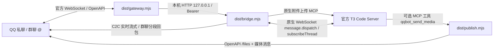

# T3 Code QQBot Plugin (`t3-code-qqbot`)

将**官方 QQ 机器人（OpenAPI WebSocket）**接入本地 **T3 Code** 的跨平台桥接插件，原生支持 **Windows** 与 **Linux**。

无需修改或重编译 T3 Code 本体，开箱适配官方桌面端与命令行版 T3 Code。



## 核心特性

- **双平台原生兼容**：支持 Windows 10/11（自动解析 `%USERPROFILE%\.t3\bin\t3.cmd` Electron 包装与独立 `t3.exe`）与 Linux（自动探测 `~/.t3/bin/t3`、`~/.local/bin/t3` 及 `PATH`）。
- **原生 T3 协议链路**：直接通过 T3 原生 WebSocket（`message.dispatch` + `orchestration.subscribeThread`）投递与订阅回复，不向聊天正文拼接任何多余标记；私聊支持 QQ 官方 `StreamSession` 实时流式输出，首帧失败自动降级普通消息。
- **双向富媒体与附件**：
  - 入站：支持 QQ 图片、语音、普通文件自动下载落盘（HTTPS 域名白名单 + 文件头嗅探 + 单件 12 MiB / 单消息 10 件上限），并通过 T3 原生附件接口上传给模型。
  - 出站：通过独立 MCP 工具 `qqbot_send_media`（`dist/publish.mjs`）从绑定工作区内安全回传图片/文件至当前 QQ 对话，严格拦截路径穿越与 Windows UNC 外联。
- **幂等与断点恢复**：持久化 `.received`、`.run.json` 与 `.delivered` 状态；提交或下载失败自动释放去重锁，中途断线可在桥接在线时直接通过 `recover <runId>` 补发回复而无需重跑模型。
- **单机一键启动 & 双机分离皆可**：默认 `t3-qqbot start` 一键同时托管网关与桥接；也支持 Linux 服务器单跑 `gateway` + SSH 隧道转发至 Windows/另一台主机跑 `bridge`。

## 3 分钟快速开始

> 首次配置（包含 QQ 开放平台创建机器人、获取 `user_openid`、配置媒体回传与后台常驻）请阅读完整教程：[docs/SETUP.md](./docs/SETUP.md)。

### 方式一：通过 npm 全局安装（推荐）

需 **Node.js >= 24.0.0**。

```bash
# 1. 全局安装
npm i -g t3-code-qqbot

# 2. 创建工作目录并初始化 config.json 与 credentials.json（自动生成随机 bridgeSecret 并探测 T3 CLI）
mkdir t3-qqbot && cd t3-qqbot
t3-qqbot init

# 3. 编辑 credentials.json，填入 QQ 开放平台的 appId 与 appSecret

# 4. 启动服务并给你的 QQ 机器人发一条消息，从日志复制你的 c2c:<user_openid>
t3-qqbot start

# 5. 绑定 QQ 会话到 T3 工作区（可选加 --thread <threadId> 绑定已有会话，加 --install-media-mcp 启用回传文件）
t3-qqbot bind --scope c2c:<你的user_openid> --workspace "<T3已注册的项目路径>" --install-media-mcp

# 6. 体检并重启服务
t3-qqbot doctor
t3-qqbot start
```

### 方式二：下载 GitHub Release 离线发布包

从 Releases 下载 `t3-code-qqbot-v1.0.0.zip`（Windows）或 `t3-code-qqbot-v1.0.0.tar.gz`（Linux），解压后执行：

```bash
npm ci --omit=dev
node dist/cli.mjs init
```

> **提示**：如果你是通过 `git clone` 克隆源码仓库，请先执行 `npm ci && npm run build` 生成 `dist/`，再运行上述命令。

## CLI 命令一览

| 命令 | 说明 |
|---|---|
| `t3-qqbot init [--dir <dir>] [--force]` | 生成 `config.json` 与 `credentials.json`（含随机 32 字节 `bridgeSecret`） |
| `t3-qqbot start [--config <path>]` | 单机模式：自动依次启动 `bridge` 与 `gateway`，Ctrl+C 优雅同停 |
| `t3-qqbot bridge [--config <path>]` | 仅启动 T3 桥接服务（默认监听 `127.0.0.1:18773`） |
| `t3-qqbot gateway [--config <path>]` | 仅启动 QQ 官方 WebSocket 网关（支持双机分离最小配置） |
| `t3-qqbot bind --scope <scope> [--workspace <dir>] [--thread <id>] [--install-media-mcp] [--config <path>]` | 校验并写入 QQ 与 T3 工作区/会话绑定 |
| `t3-qqbot doctor [--config <path>]` | 6 步全链路体检（Node 版本、配置、本地凭据、T3 CLI、T3 服务、原生附件上传回环） |
| `t3-qqbot recover <runId> [--config <path>]` | 对指定 T3 `runId` 补发未完成的 QQ 回复（支持桥接在线时执行，不占用监听端口） |

## 从源码构建（开发者）

```bash
npm ci
npm run typecheck
npm test
npm run build
# 生成 Windows (.zip) 与 Linux (.tar.gz) 干净发布包到 release/
npm run package
```

## 安全设计说明

- 桥接 HTTP 仅允许绑定回环地址（`127.0.0.1` / `localhost` / `::1`），使用常量时间比较校验 `Authorization: Bearer <bridgeSecret>`。
- T3 通信仅允许连接本地回环 `t3.origin`，子进程自动剥离 `QQ_*` 凭据环境变量；所有 T3 会话令牌按需签发并在任务结束或退出时自动吊销。
- 入站附件强制 HTTPS 域名白名单 + 12 MiB 上限 + 单消息 10 件上限；出站媒体先拦截 UNC/越界路径再通过 `realpath` 严格限制在对应绑定的工作区目录内。
- 本发布版**不包含**任何私有账号凭据、私有路径或定制 T3 服务端补丁。

## 许可证

MIT
