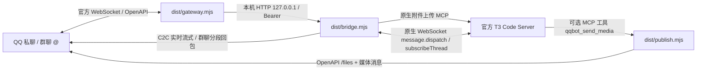

# T3 Code QQBot Plugin (`t3-code-qqbot`)

将**官方 QQ 机器人（OpenAPI WebSocket）**接入本地 **T3 Code** 的跨平台桥接插件，原生支持 **Windows** 与 **Linux**。

无需修改或重编译 T3 Code 本体，开箱适配官方桌面端与命令行版 T3 Code。



## 核心特性

- **双平台原生兼容**：支持 Windows 10/11（自动解析 `%USERPROFILE%\.t3\bin\t3.cmd` Electron 包装与独立 `t3.exe`）与 Linux（自动探测 `~/.t3/bin/t3`、`~/.local/bin/t3` 及 `PATH`）。
- **终端扫码一键接入**：内置 `@tencent-connect/qqbot-connector`，`t3-qqbot init` / `t3-qqbot login` 支持手机 QQ 扫码直接拿到 `AppID`、`AppSecret` 和 `user_openid`，免去手抄密钥。
- **QQ 聊天内全套斜杠指令面板**：手机端直接发 `/model`（支持 `4n`/`4c`/`4a`/`4h`/`3.8f`/`sonnet`/`opus`/`sol` 等超短简写与跨 Provider 切换）、`/think`、`/provider`、`/new`、`/threads`、`/use`、`/rewind`（`/undo`/`/撤回`）、`/compact`、`/status`、`/tasks`、`/cancel`（`/stop`）、`/update`、`/help`。
- **原生 T3 协议链路**：直接通过 T3 原生 WebSocket（`message.dispatch` + `orchestration.subscribeThread`）投递与订阅回复，不向聊天正文拼接任何多余标记；私聊收到消息即显示 QQ 左上角**「对方正在输入…」**并每 50 秒自动续期保活，配合 `StreamSession` 实时流式输出，首帧失败自动降级普通消息。
- **双向富媒体与附件**：
  - 入站：支持 QQ 图片、语音、视频、Word/Office 文档与普通文件自动流式下载落盘（强制 HTTPS + 反 SSRF 私网/回环/元数据 IP 拦截，默认不再硬卡易变的 CDN 域名白名单，亦支持在 `attachmentHosts` 按需收紧；全媒体魔数嗅探 + 默认单件 200 MiB / 单消息 10 件，可在 `config.json` 的 `attachments` 自定义）；单图 `≤ 10 MiB` 走 T3 原生图片附件，普通文件/视频/大图 `≤ 50 MiB` 走 T3 原生流式上传，超过 T3 单件 50 MiB 上限的大文件自动保留在 `<workspace>/attachments/` 并以本地绝对路径交付给 AI 代理直接处理。
  - 出站：通过独立 MCP 工具 `qqbot_send_media`（`dist/publish.mjs`）从绑定工作区内安全回传图片/视频(`.mp4`)/语音(`.silk`)/文件至当前 QQ 对话（匹配 QQ 官方 SDK 分片上传上限：图 30 MiB / 语音 20 MiB / 视频与文件 100 MiB），严格拦截路径穿越与 Windows UNC 外联。
- **幂等与断点恢复**：持久化 `.received`、`.run.json` 与 `.delivered` 状态；提交或下载失败自动释放去重锁，中途断线可在桥接在线时直接通过 `recover <runId>` 补发回复而无需重跑模型。
- **单机一键启动 & 双机分离皆可**：默认 `t3-qqbot start` 一键同时托管网关与桥接；也支持 Linux 服务器单跑 `gateway` + SSH 隧道转发至 Windows/另一台主机跑 `bridge`。

## 文档导航

| 文档 | 说明 |
|---|---|
| [完整配置教程（docs/SETUP.md）](./docs/SETUP.md) | 从 0 开始建号、扫码绑定、附件回传、守护常驻与双机分离部署 |
| [系统架构与协议（docs/ARCHITECTURE.md）](./docs/ARCHITECTURE.md) | 进程拓扑、T3 原生 WebSocket 协议、流式保活、`/update` 与 Windows 零窗口原理 |
| [运维、排障与发版手册（docs/OPERATIONS.md）](./docs/OPERATIONS.md) | 守护管理、无窗口核验命令、断点补发（`recover`）与标准发版 SOP |
| [更新日志（CHANGELOG.md）](./CHANGELOG.md) | `v1.0.0` ~ `v1.2.5` 完整简体中文版本演进记录 |
| [安全策略（SECURITY.md）](./SECURITY.md) · [贡献指南（CONTRIBUTING.md）](./CONTRIBUTING.md) | 安全边界声明、开发规范与提交流程 |

## 3 分钟快速开始

> 首次配置（包含 QQ 开放平台创建机器人、获取 `user_openid`、配置媒体回传与后台常驻）请阅读完整教程：[docs/SETUP.md](./docs/SETUP.md)。

### 方式一：通过 npm 全局安装（推荐）

需 **Node.js >= 24.0.0**。

```bash
# 1. 全局安装
npm i -g t3-code-qqbot

# 2. 创建工作目录并运行交互式安装向导（引导填凭据、群聊@、侧边栏收纳、可选静音、绑定与一键开机自守护）
mkdir t3-qqbot && cd t3-qqbot
t3-qqbot init
# 自动化/无交互脚本可加 --yes 生成默认配置，随时用 t3-qqbot config 打开配置菜单修改

# 3. 若第 2 步尚未拿到 openid：前台启动一次给 QQ 机器人发条消息，从日志复制 c2c:<user_openid>
t3-qqbot start

# 4. 绑定 QQ 会话到 T3 工作区（加 --install-media-mcp 启用 AI 回传图片/文件）
t3-qqbot bind --scope c2c:<你的user_openid> --workspace "<T3已注册的项目路径>" --install-media-mcp

# 5. 体检并启用后台自守护（若向导中已启用可跳过）
t3-qqbot doctor
t3-qqbot service install
```

### 方式二：下载 GitHub Release 离线发布包

从 Releases 下载 `t3-code-qqbot-v1.2.5.zip`（Windows）或 `t3-code-qqbot-v1.2.5.tar.gz`（Linux），解压后执行：

```bash
npm ci --omit=dev
node dist/cli.mjs init
```

> **提示**：如果你是通过 `git clone` 克隆源码仓库，请先执行 `npm ci && npm run build` 生成 `dist/`，再运行上述命令。

## QQ 聊天内斜杠指令面板

在已绑定的 QQ 私聊或群聊 `@机器人` 中直接发送（可在 `t3-qqbot config` 关闭 `bridge.enableSlashCommands`）：

| 指令（含别名） | 示例 | 说明 |
|---|---|---|
| `/help` (`/?`, `/menu`) | `/help` | 查看全部快捷指令清单 |
| `/model` (`/m`) | `/model` · `/model 4h xhigh` · `/model 3.8f` · `/model codex/sol` | 查看当前 Provider 可用模型编号，或自适应简写/编号/跨 Provider 切换模型 |
| `/think` (`/t`) | `/think low` (`/t l`) · `/think xh` | 切换思考/推理强度（自动适配 Antigravity / Codex / Claude 档位键） |
| `/provider` (`/p`) | `/provider` · `/provider 2` | 查看或切换当前会话的 T3 Provider 账号实例 |
| `/new` (`/reset`) | `/new 新话题` | 在当前项目开新 T3 会话（自动继承模型与思考强度），旧会话完整保留 |
| `/threads` (`/list`) | `/threads` | 列出当前项目最近 10 条 T3 会话（带编号） |
| `/use` (`/switch`) | `/use 2` · `/use main` | 切换到指定历史会话或一键切回配置默认主会话 |
| `/rewind` (`/undo`, `/撤回`) | `/rewind` · `/撤回 2` · `/rewind 1 --files` | 调用 T3 原生 `checkpoint.rollback` 在当前会话原地撤回最近 1-10 轮（默认仅撤回对话不改文件，加 `--files` 同时还原工作树文件） |
| `/compact` | `/compact 保留关键结论` | 透传给当前 T3 会话执行原生上下文压缩 |
| `/status` (`/info`) | `/status` | 查看当前会话 ID、Provider、模型、运行状态与后台任务数 |
| `/tasks` & `/cancel` (`/stop`) | `/tasks` · `/stop` · `/cancel all` | 查看后台任务，或立即中断当前轮次/取消委派子任务 |
| `/update` (`/upgrade`) | `/update` | 自动检查并拉取更新后热重启：npm 全局安装自动执行 `npm install -g`、离线包目录自动从 npm 拉取官方包覆盖（保留本地配置与状态）、源码仓库自动 `git pull` 重建 |

## CLI 命令一览

| 命令 | 说明 |
|---|---|
| `t3-qqbot init [--dir <dir>] [--force] [--yes]` | 交互式安装向导（扫码/手动填凭据、可选项、绑定与一键开机自启动；`--yes` 静默生成默认配置） |
| `t3-qqbot login [--config <path>]` | 终端扫码一键绑定 QQ 机器人（自动保存 `AppID`/`AppSecret` 并输出 `c2c:<user_openid>`） |
| `t3-qqbot config [show\|set <key> <val>] [--config <path>]` | 打开交互式配置菜单（凭据/T3/桥接/绑定/白名单/静音与收纳/守护服务/体检），或非交互读写单项配置 |
| `t3-qqbot start [--config <path>] [--supervise]` | 单机模式：自动依次启动 `bridge` 与 `gateway`（`--supervise` 崩溃自动指数退避重启） |
| `t3-qqbot service <install\|status\|start\|stop\|restart\|uninstall>` | 一键注册与管理本机后台自守护（Windows 无黑框计划任务 / Linux `systemd --user`） |
| `t3-qqbot bridge [--config <path>]` | 仅启动 T3 桥接服务（默认监听 `127.0.0.1:18773`） |
| `t3-qqbot gateway [--config <path>]` | 仅启动 QQ 官方 WebSocket 网关（支持双机分离最小配置） |
| `t3-qqbot bind --scope <scope> [--workspace <dir>] [--thread <id>] [--install-media-mcp] [--config <path>]` | 校验并写入 QQ 与 T3 工作区/会话绑定 |
| `t3-qqbot doctor [--config <path>]` | 6 步全链路体检（Node 版本、配置、本地凭据、T3 CLI、T3 服务、原生附件上传回环） |
| `t3-qqbot recover <runId> [--config <path>]` | 对指定 T3 `runId` 补发未完成的 QQ 回复（支持桥接在线时执行，不占用监听端口） |

## 从源码构建（开发者）

```bash
npm ci
npm run typecheck
npm test
npm run build
# 生成 Windows (.zip) 与 Linux (.tar.gz) 干净发布包到 release/
npm run package
```

## 安全设计说明

- 桥接 HTTP 仅允许绑定回环地址（`127.0.0.1` / `localhost` / `::1`），使用常量时间比较校验 `Authorization: Bearer <bridgeSecret>`。
- T3 通信仅允许连接本地回环 `t3.origin`，子进程自动剥离 `QQ_*` 凭据环境变量；所有 T3 会话令牌按需签发并在任务结束或退出时自动吊销。
- 入站附件强制 HTTPS + 反 SSRF（拒绝本机/私网/元数据 IP 及非默认端口，并支持可选 `attachmentHosts` 收紧）+ 流式落盘（默认单件 200 MiB / 单消息 10 件，可配置）；出站媒体先拦截 UNC/越界路径再通过 `realpath` 严格限制在对应绑定的工作区目录内，并按 QQ 官方 SDK 分类型上限校验。
- 本发布版**不包含**任何私有账号凭据、私有路径或定制 T3 服务端补丁。

## 许可证

MIT
