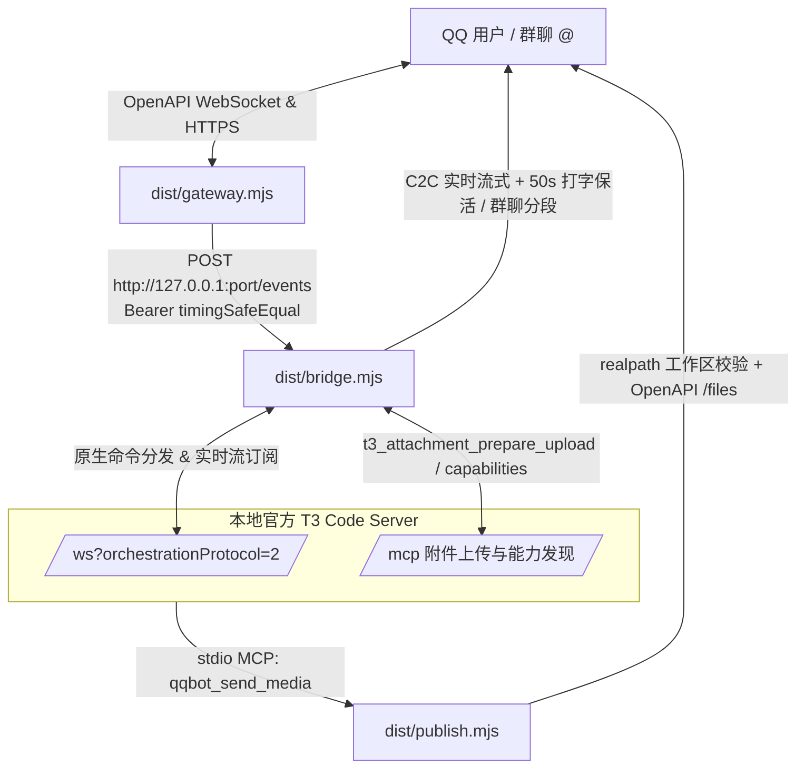
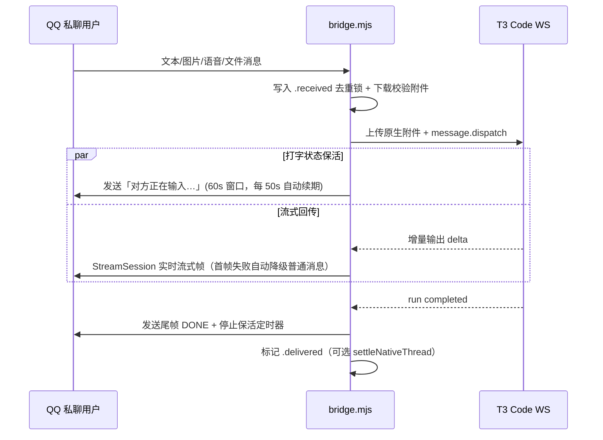

# T3 Code QQBot 系统架构与协议设计

本文档描述 `t3-code-qqbot` 的核心架构、进程边界、T3 Code 原生协议交互链路、Windows 零窗口后台守护原理及幂等恢复机制。

---

## 1. 总体进程与通信拓扑

插件由 4 个 `esbuild` 打包的独立 ESM 入口组成，可在单机下由 `cli.mjs start --supervise` 统一拉起，也可将 `gateway.mjs` 与 `bridge.mjs` 拆至两台主机经 SSH 加密隧道互联：

### 各入口职责
- **`dist/cli.mjs`**：命令分发、交互式向导（`init` / `config` / `login`）、跨平台守护管理（`service`）、单机监督进程（`start --supervise [--log-file <path>]`）。
- **`dist/gateway.mjs`**：持有 QQ 官方 WebSocket 长连接，过滤私聊与群聊 `@` 事件，将标准化入站事件签名转发给本地 `bridge`。
- **`dist/bridge.mjs`**：核心中枢，负责作用域鉴权与绑定路由、斜杠指令拦截、附件安全下载并上传至 T3、原生 WS 派发与流式订阅、幂等持久化与断点补发（`recover`）。
- **`dist/publish.mjs`**：独立运行的 stdio MCP Server，向 T3 内的 AI 代理暴露 `qqbot_send_media` 工具，仅需 `appId`/`appSecret`，不需要 `bridgeSecret`。

---

## 2. T3 Code 原生协议链路（`src/t3-ws.ts` + `src/observe.ts`）

### 2.1 会话令牌与认证（`src/t3-cli.ts`）
- 自动定位本机 T3 CLI（Windows 自动解析 `%USERPROFILE%\.t3\bin\t3.cmd` 提取 Electron 可执行文件与 `server.asar/.../bin.mjs`，附带 `ELECTRON_RUN_AS_NODE=1`；Linux 自动探测 `~/.t3/bin/t3`、`~/.local/bin/t3` 及 `PATH`）。
- 派生子进程前通过 `sanitizeChildEnv` 强制剥离全部 `QQ_*` 环境变量。
- 按需签发短期会话令牌（`orchestration:read` + `orchestration:operate`），遇 `HTTP 401` 自动续期重连一次，进程退出时自动吊销。

### 2.2 原生 WebSocket 控制矩阵（`/ws?orchestrationProtocol=2`）
为避免独立 MCP 客户端受限于 `approval-required` 权限上限而触发 `runtime_mode_escalation_denied`，全部会话变更指令均通过 `orchestration.dispatchCommand` 走原生 WebSocket：

| 能力 | 原生命令 / 方法 | 关键细节 |
|---|---|---|
| 投递对话消息 | `message.dispatch` | 支持原生 `attachments` 列表，不拼接额外提示前缀 |
| 实时流订阅 | `orchestration.subscribeThread` | 监听增量文本流与运行终态，排除前台已完结子代理的后台任务误报 |
| 原地撤回（`/rewind`） | `checkpoint.rollback` | 默认仅撤回对话不改文件，加 `--files` 还原工作树；兼容第 0 轮回退时 run 被裁剪导致 `lastRunOrdinal` 归 `null` 的完成判定 |
| 切换模型 / 思考强度 | `setThreadModelSelection` | 结合 `orchestrator_capabilities`（含 `search` 兜底）解析简写、编号与跨 Provider 切换 |
| 创建新会话（`/new`） | `createNativeThread` | 默认 `runtimeMode: 'full-access'`、`interactionMode: 'default'`，自动继承模型配置 |
| 中断任务（`/stop` / `/cancel`） | `stopNativeThread` | 立即终止当前运行轮次，支持级联取消委派子任务 |
| 侧边栏自动收纳 | `settleNativeThread` | `bridge.autoSettleThread: true` 时在每轮完成后自动收起侧边栏活跃态 |

---

## 3. 入站流式回包与「正在输入」保活（`src/bridge.ts`）

---

## 4. `/update` 三模式自动更新与退出码 `75` 热重启

`src/slash-commands.ts` 中的 `handleSelfUpdate` 自动探测安装形态并执行对应升级路径：

1. **`git` 源码仓库**：执行 `git pull --ff-only` $\to$ `npm install` $\to$ `npm run build`。
2. **`npm-global` 全局安装**：查询 `https://registry.npmjs.org/t3-code-qqbot/latest`，以 `os.tmpdir()` 为工作目录通过 `process.execPath` 直接调用 `npm-cli.js install -g t3-code-qqbot@<latest>`（规避 Windows 下目录占用 `EBUSY` 及 `cmd.exe` 引号转义问题）。
3. **`standalone` 离线解压目录**：下载官方 npm `.tgz` 至临时目录解压校验后，仅覆盖 `dist/`、`docs/`、`scripts/`、`package.json` 等运行时文件，**绝对不动 `config.json`、`credentials.json` 与 `state/`**；若依赖清单变化自动补跑 `npm install --omit=dev`。

更新完成后，`bridge.mjs` 优雅关闭 HTTP 与 WS 连接并以 **`SELF_UPDATE_EXIT_CODE = 75`** 退出；外层 `cli.mjs --supervise` 捕获退出码 `75` 后跳过指数退避，**0 秒等待立即拉起新版子进程**。

---

## 5. Windows 零窗口守护与旧版自动热迁移（`src/service.ts`）

### 5.1 为什么彻底淘汰 `powershell.exe -WindowStyle Hidden`
`powershell.exe` / `pwsh.exe` / `cmd.exe` 属于 `IMAGE_SUBSYSTEM_WINDOWS_CUI` 子系统，进程启动瞬间系统就会先分配控制台宿主；在 Windows 11（默认终端为 Windows Terminal）下，`WindowsTerminal.exe` 会忽略子进程自发的 `SW_HIDE`，导致桌面与任务栏永久残留黑框。

### 5.2 零窗口实现架构
- 计划任务直接注册 GUI 子系统程序 **`C:\Windows\System32\wscript.exe`**，参数为 `//B //Nologo "<stateDir>\run-service.vbs"`。
- `run-service.vbs` 以 **UTF-16 LE BOM** 写入（100% 兼容含中文/空格路径），内部设置 `NODE_NO_WARNINGS=1` 后调用 `WScript.Shell.Run(cmd, 0, True)` 在 `CreateProcess` 阶段注入 `SW_HIDE` 并同步等待退出码。
- `cli.mjs start --supervise --log-file "<stateDir>\service.log"` 原生以 `['ignore', 'pipe', 'pipe']` + `windowsHide: true` 接管子进程输出并带本地时间戳写入日志文件，彻底移除 PowerShell 日志管道层。

### 5.3 旧版 `run-service.ps1` 自动活体热迁移
从 `v1.2.4` 起，`bridge.mjs` 启动就绪与 `service start / restart` 会自动调用 `migrateLegacyWindowsServiceTask`：
1. 若 `state\run-service.ps1` 不存在则直接 O(1) 返回（零开销）；
2. 若发现根路径 `\` 下存在指向旧 `run-service.ps1` 的计划任务，自动生成 `run-service.vbs` 并通过 `Set-ScheduledTask` 原子替换任务入口，随后删除旧 `run-service.ps1`；
3. 若检测到旧 `powershell.exe` 包装进程仍在运行，脱钩派生一次性无窗 `state\migrate-handover.vbs`，1.5 秒后干净关闭旧黑框进程、重新拉起升级后的 `wscript.exe` 计划任务并自毁临时脚本。

---

## 6. 幂等持久化与断点恢复

所有运行时状态统一存于 `stateDir`（默认 `./state`）：

- `<hash>.received`：入站事件去重锁；下载或提交 T3 失败时自动释放锁，避免误吞重发消息。
- `<hash>.run.json`：已受理的 `runId`、`threadId` 与回包地址快照。
- `<hash>.delivered`：已成功回传 QQ 的完结标记。
- `bindings/<scopeHash>.thread`：当前 QQ 会话的动态活跃线程覆盖（供 `/new`、`/use` 持久化切换）。

若中途崩溃导致回复未送达，可在桥接在线时执行 `t3-qqbot recover <runId>` 读取 `.run.json` 拉取 T3 最终答复补发，不重跑模型。
